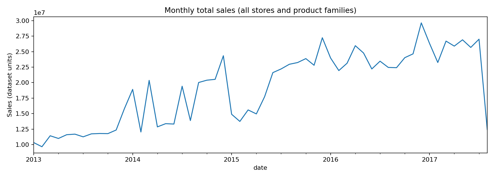
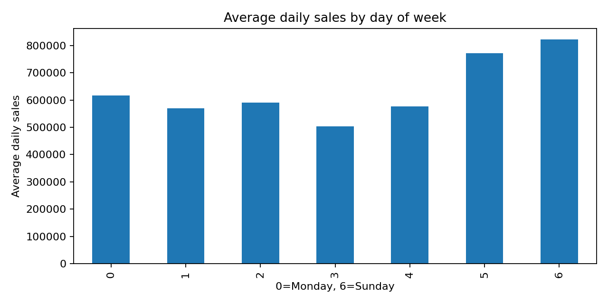
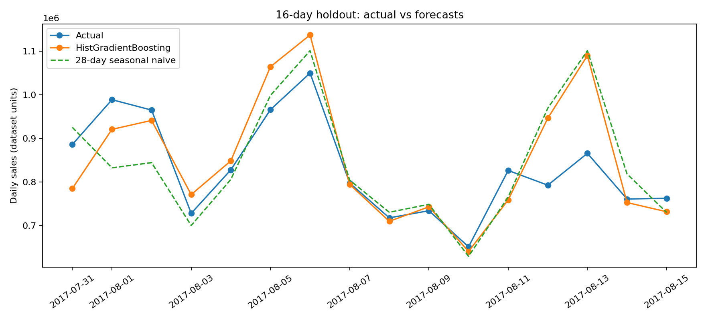
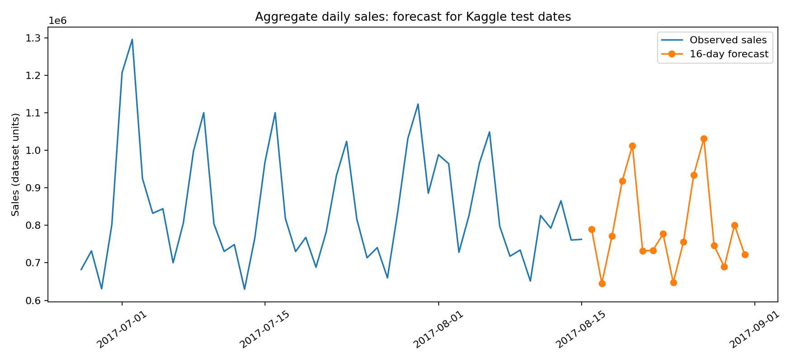

# Store Sales Forecasting — Time Series ML

Portfolio project using the **Kaggle Store Sales — Time Series Forecasting** dataset (Corporación Favorita). Predicts **aggregate daily sales** across stores and product families, not individual store/family sales.

## What this project demonstrates
- Aggregating a large panel dataset into a daily time series
- EDA of monthly and weekday patterns
- Horizon-safe lagged and rolling features for a **16-day** forecast
- Chronological holdout (no random shuffle)
- Seasonal naive benchmark vs `HistGradientBoostingRegressor`
- MAE / RMSE and forecast visualizations
- Forward predictions for Kaggle's 16-day test period

## Results (last 16 historical days)

| Model | MAE | RMSE |
|---|---:|---:|
| Seasonal naive (28-day lag) | 66,741 | 93,799 |
| HistGradientBoosting | 59,785 | 84,621 |

> The model is evaluated on a single fixed holdout. A production assessment needs rolling-origin validation. The forecast is **not** a valid Kaggle submission because Kaggle requires separate predictions for every store/family row.

## Charts

## Run locally

1. Create and activate a Python virtual environment.
2. Install: `pip install -r requirements.txt`
3. Start: `jupyter notebook`
4. Open `store_sales_forecasting.ipynb` and run all cells.

Input CSVs are in `data/`. Outputs are in `outputs/`. The original Kaggle competition data is included for reproducibility. Please observe Kaggle dataset terms when redistributing.

## Data and feature availability

The notebook uses `train.csv` and `test.csv` only. It uses future `onpromotion` values supplied by Kaggle, but no future `sales` values. Sales lags start at 16 days; rolling windows are shifted 16 days. Other CSV files are retained for potential future extensions.

## Limitations

National aggregate forecast only; one holdout period; no external regressors from oil/holiday/store metadata; no store-level or product-family-level predictions.
